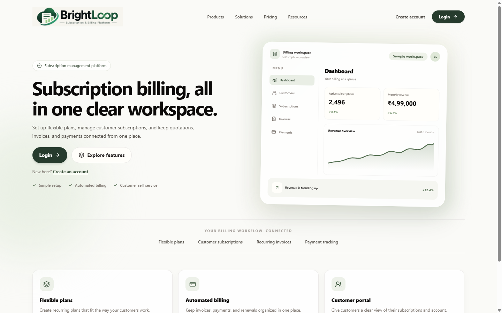
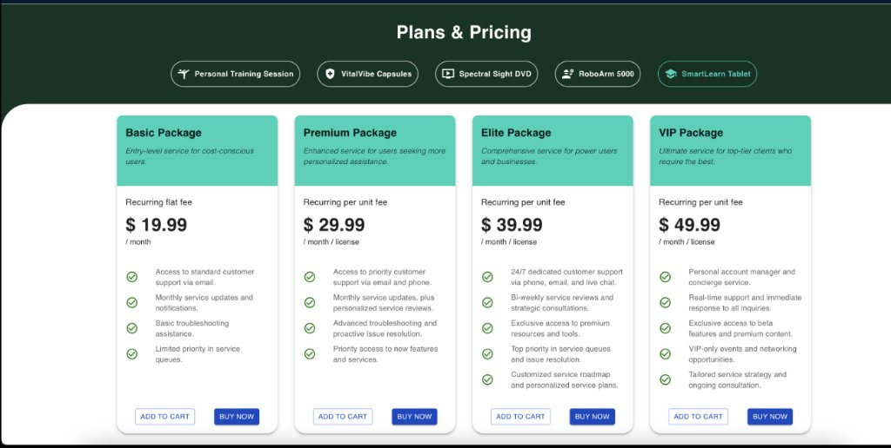
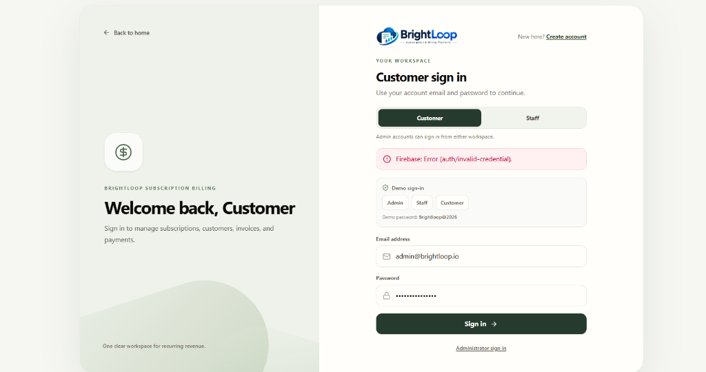
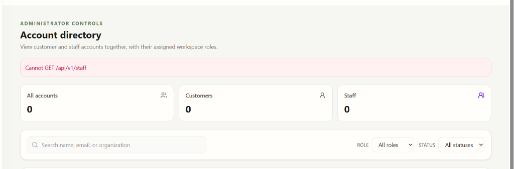
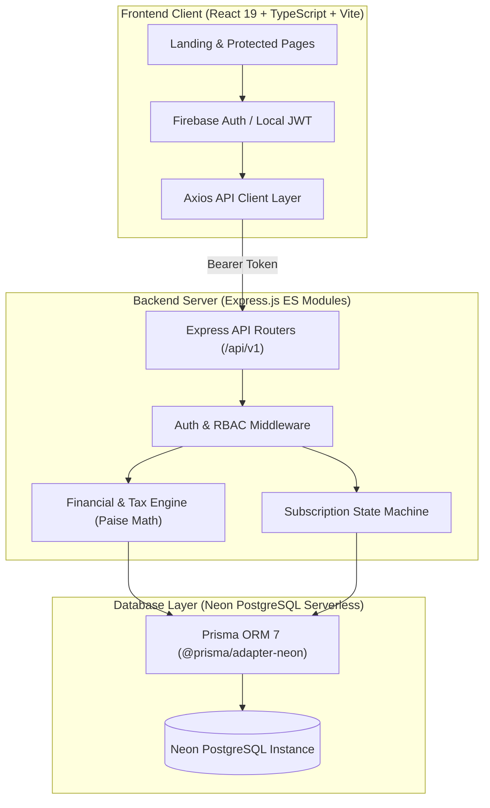

<p align="center">
  
</p>

<p align="center">
  <strong>Next-Generation Subscription Commerce, Recurring Billing & Financial Ledger Engine</strong>
</p>

<p align="center">
  
  
  
  
  
  
  
</p>

---

## 📌 Table of Contents

- [Overview](#-overview)
- [Key Features](#-key-features)
- [Screenshots & UI Walkthrough](#-screenshots--ui-walkthrough)
- [Application Architecture](#-application-architecture)
- [Workspaces & Role-Based Access Control](#-workspaces--role-based-access-control)
- [Financial Calculation & Billing Engine](#-financial-calculation--billing-engine)
- [Demo Credentials](#-demo-credentials)
- [Project Directory Structure](#-project-directory-structure)
- [Getting Started & Local Setup](#-getting-started--local-setup)
- [API Reference](#-api-reference)
- [Automated Testing & Verification](#-automated-testing--verification)

---

## 🚀 Overview

**BrightLoop Billing** is an enterprise-grade subscription management and recurring billing platform engineered for modern software and cloud-services businesses. 

It powers the entire subscription commerce lifecycle:
1. **Catalog & Plan Browsing**: Service presentation with dynamic categories, recurring flat-fee/per-unit tiers, and SLA highlights.
2. **Quotation & Order Generation**: Instant quotation generation, negotiation, and conversion into confirmed subscriptions.
3. **Automated Invoicing & Period Anchoring**: Pro-rated initial invoices, billing periods, and month-end anniversary anchor handling (Jan 31 &rarr; Feb 28/29 &rarr; Mar 31).
4. **Zero-Gateway UPI Payment Claims**: Interactive UPI QR code generation, client payment claim submission with UTR tracking, and manual staff verification with automated subscription activation.
5. **Exact Integer Paise Ledger**: 100% integer arithmetic (in paise) to completely prevent floating-point calculation drift across Indian GST taxes and tiered discounts.

---

## ✨ Key Features

| Domain | Highlights |
| :--- | :--- |
| **💳 Product & Pricing** | Multi-tier plans (Starter, Professional, Enterprise, VIP), flexible billing intervals (weekly, monthly, quarterly, yearly), minimum quantities, and trial periods. |
| **🧾 Invoicing & Taxes** | Indian GST compliant tax engine (18% GST split into 9% CGST + 9% SGST for intra-state or 18% IGST for inter-state) with half-up basis point precision. |
| **🏷️ Smart Discounts** | Fixed rupee discounts or percentage basis-point discounts with minimum order thresholds and subtotal caps. |
| **📱 UPI QR Payments** | Instant dynamic UPI QR codes with payee VPA (`brightloop@upi`), invoice amount pre-filled, and one-click UTR payment claim submission. |
| **🔄 Lifecycle Machine** | Strict state machine transitions: `draft` &rarr; `quotation` &rarr; `confirmed` &rarr; `active` &rarr; `paused` &rarr; `closed`. |
| **🛡️ Dual-Layer Auth** | Hybrid authentication engine supporting Firebase Auth (client SDK + Admin SDK) with seamless native PostgreSQL HMAC JWT fallback. |
| **📊 Real-Time Analytics** | Revenue analytics, Monthly Recurring Revenue (MRR), Annual Run Rate (ARR), overdue aging buckets, and collection rates. |

---

## 📸 Screenshots & UI Walkthrough

### 1. Modern Landing Page
The primary entry point showcasing BrightLoop's value proposition, featured subscription offerings, and instant access to the workspaces.

<p align="center">
  
</p>

---

### 2. Plans & Pricing Catalog (Customer Self-Service)
A modern dark-green header with dynamic category pill filters (`Cloud Hosting`, `Business Email`, `Web Development`, `Cybersecurity`), mint package banners, clear recurring fee badges, bold pricing, feature checklists, and dual **ADD TO CART** / **BUY NOW** buttons.

<p align="center">
  
</p>

---

### 3. Role-Based Authentication & Workspace Switcher
Unified login experience supporting Customer, Operations Staff, and Administrator workspaces with instant demo sign-in shortcuts.

<p align="center">
  
</p>

---

### 4. Administrator Control Panel & Account Directory
Full oversight of all customer and staff accounts, instant role switching (Customer &harr; Staff), audit logging, and team member management.

<p align="center">
  
</p>

---

## 🏗 Application Architecture

The system follows a decoupled three-tier architecture ensuring strict separation between UI presentation, business validation, and the transactional database ledger:



---

## 👥 Workspaces & Role-Based Access Control

BrightLoop Billing provides three distinct experiences over a shared backend:

| Role | Workspace Route | Capabilities |
| :--- | :--- | :--- |
| **Administrator** | `/dashboard`, `/staff-management`, `/settings` | Complete business oversight: revenue metrics, staff invitations, tax rules, discount rules, product & plan creation, payment allocations. |
| **Operations Staff** | `/dashboard`, `/customers`, `/subscriptions`, `/invoices`, `/payments` | Operational execution: review incoming payment claims, verify UTR codes, activate confirmed subscriptions, triage overdue invoices. |
| **Customer** | `/portal`, `/portal/catalog` | Self-service: browse plan catalog, subscribe, receive GST invoices, pay via UPI QR, track claim statuses, and download receipts. |

---

## 🧮 Financial Calculation & Billing Engine

All monetary calculations in BrightLoop Billing strictly follow these invariants:

1. **Integer Arithmetic (Paise Precision)**:  
   No floating-point numbers are used for financial transactions. ₹499.00 is strictly stored and computed as `49900n` (PostgreSQL `BIGINT`).
2. **Indian GST Calculation**:
   - **Intra-State**: Split into 9% CGST (`900 bps`) + 9% SGST (`900 bps`) = 18% GST.
   - **Inter-State**: Billed as 18% IGST (`1800 bps`).
   - Rounding applies banker's half-up rounding: `Math.floor((subtotal * rateBps + 5000) / 10000)`.
3. **Month-End Anchor Date Arithmetic**:  
   Subscriptions starting on the 31st automatically preserve month-end integrity (e.g. Jan 31 &rarr; Feb 28 in non-leap years &rarr; Mar 31 &rarr; Apr 30 &rarr; May 31).

---

## 🔑 Demo Credentials

All seeded demo accounts share the standard development password: `Brightloop@2026`.

| Role | Email | Password | Default Redirect |
| :--- | :--- | :--- | :--- |
| **Administrator** | `admin@brightloop.io` | `Brightloop@2026` | `/dashboard` |
| **Staff (Operations)** | `staff.operations@brightloop.io` | `Brightloop@2026` | `/dashboard` |
| **Staff (Support)** | `staff.support@brightloop.io` | `Brightloop@2026` | `/dashboard` |
| **Customer (Acme Corp)** | `customer1@acme.corp` | `Brightloop@2026` | `/portal` |
| **Customer (InfoSolutions)** | `finance@infosolutions.in` | `Brightloop@2026` | `/portal` |

---

## 📂 Project Directory Structure

```text
management_system/
├── frontend/                                # React 19 + TypeScript + Vite + Tailwind CSS
│   ├── public/                              # Static public assets (logo.png, favicon.svg)
│   ├── src/
│   │   ├── assets/                          # Brand imagery and graphics
│   │   ├── components/                      # UI components (Sidebar, Navbar, Modals)
│   │   ├── pages/                           # Application views & dashboards
│   │   │   ├── auth/                        # LoginPage.tsx, StaffSignupPage.tsx
│   │   │   ├── Dashboard.tsx                # Admin / Staff KPI overview
│   │   │   ├── Portal.tsx                   # Customer self-service portal
│   │   │   ├── Customers.tsx                # Customer database management
│   │   │   ├── Accounts.tsx                 # Composite user & staff directory
│   │   │   ├── Subscriptions.tsx            # Subscription lifecycle management
│   │   │   ├── Invoices.tsx                 # Invoice ledger & PDF views
│   │   │   ├── Payments.tsx                 # Payments & UPI Claim verification
│   │   │   └── Plans.tsx                    # Plan configuration
│   │   ├── services/                        # api.ts, firebase.ts
│   │   ├── types/                           # TypeScript data interfaces
│   │   └── utils/                           # Formatters (currency, dates)
│   ├── package.json
│   └── vite.config.ts
├── brightloop-billing/server/               # Express.js REST API + Prisma ORM
│   ├── src/
│   │   ├── config/                          # Environment variables & runtime settings
│   │   ├── database/                        # Prisma client & connection pools
│   │   ├── middleware/                      # firebaseAuth.js, authorize.js, notFound.js
│   │   ├── modules/                         # Feature domain modules
│   │   │   ├── auth/                        # Native JWT & Firebase user synchronization
│   │   │   ├── catalog/                     # Customers, products, and plan queries
│   │   │   ├── billing/                     # Invoice creation & month-end calculations
│   │   │   ├── payments/                    # UPI claims & payment allocation
│   │   │   ├── subscriptions/               # State machine transitions & renewals
│   │   │   ├── quotations/                  # Estimates & quotation conversion
│   │   │   ├── staff/                       # Staff management & role switching
│   │   │   └── analytics/                   # Revenue, MRR, ARR, and overdue metrics
│   │   ├── utils/                           # BigInt JSON serialization, ApiError
│   │   └── server.js                        # HTTP server bootstrap
│   ├── test/                                # 58 automated unit & integration tests
│   ├── prisma/                              # schema.prisma definition
│   └── package.json
├── docs/                                    # Architectural guides & screenshots
│   └── images/                              # High-resolution screenshots & banners
└── package.json                             # Monorepo root scripts
```

---

## 🛠 Getting Started & Local Setup

### 1. Prerequisites
- **Node.js**: `v20.x` or higher
- **npm**: `v10.x` or higher
- **PostgreSQL**: Neon Cloud Postgres connection string

### 2. Environment Configuration
Ensure `.env` exists in `brightloop-billing/server/.env`:
```env
DATABASE_URL="postgresql://<user>:<password>@<neon-host>/neondb?sslmode=require"
PORT=5000
NODE_ENV=development
CORS_ORIGINS=http://localhost:5173,http://localhost:3000
FIREBASE_PROJECT_ID=brightloop-billing
FIREBASE_SERVICE_ACCOUNT_PATH=./firebase-service-account.json
```

### 3. Install Dependencies
Run from the repository root:
```bash
# Install root, backend, and frontend packages
npm install
npm --prefix brightloop-billing/server install
npm --prefix frontend install
```

### 4. Database Setup & Seeding
```bash
# Generate Prisma Client
npm --prefix brightloop-billing/server run prisma:generate

# Populate catalog and test accounts
node brightloop-billing/server/seed-demo.mjs
```

### 5. Launch Development Servers
You can run both concurrently or in separate terminals:

```bash
# Terminal 1 — Start Backend Server (Port 5000)
node brightloop-billing/server/src/server.js

# Terminal 2 — Start Frontend Client (Port 5173)
npm --prefix frontend run dev
```

Visit **`http://localhost:5173`** to access BrightLoop Billing.

---

## 📡 API Reference

All protected endpoints require an `Authorization: Bearer <token>` header.

### Authentication & Profiles
| Method | Endpoint | Access | Description |
| :--- | :--- | :--- | :--- |
| `POST` | `/api/v1/auth/login` | Public | Direct database credential authentication. |
| `POST` | `/api/v1/auth/signup` | Public | Self-service registration (Native or Firebase ID token). |
| `GET` | `/api/v1/me` | Authenticated | Retrieve current user profile and authoritative role. |

### Subscriptions & Catalog
| Method | Endpoint | Access | Description |
| :--- | :--- | :--- | :--- |
| `GET` | `/api/v1/products` | All | Fetch active products and service offerings. |
| `GET` | `/api/v1/plans` | All | Fetch subscription pricing plans. |
| `GET` | `/api/v1/subscriptions` | Authenticated | List subscriptions (scoped to customer for users). |
| `POST` | `/api/v1/subscriptions` | Authenticated | Create a subscription and initial confirmed invoice. |
| `POST` | `/api/v1/subscriptions/:id/transition` | Admin / Staff | Trigger lifecycle transitions (`pause`, `resume`, `close`). |

### Invoices, UPI Claims & Payments
| Method | Endpoint | Access | Description |
| :--- | :--- | :--- | :--- |
| `GET` | `/api/v1/invoices` | Authenticated | List invoices with balance and status. |
| `POST` | `/api/v1/payment-claims` | Authenticated | Submit UPI transaction UTR code against an invoice. |
| `GET` | `/api/v1/payment-claims` | Admin / Staff | Review pending payment claims. |
| `POST` | `/api/v1/payment-claims/:id/verify` | Admin / Staff | Verify UTR, allocate payment, and activate subscription. |

---

## 🧪 Automated Testing & Verification

The backend includes a comprehensive automated test harness covering billing engine math, leap-year calculations, BigInt security boundaries, tax rules, and subscription state transitions:

```bash
cd brightloop-billing/server
npm test
```

### Test Suite Summary:
```text
✔ Phase 3: Automated Unit Tests — Billing Engine & Month-End Anchor Math (15 tests)
✔ customer DTO for the live Neon customer schema (7 tests)
✔ Customer Security, Validation & BIGINT Boundary Tests (7 tests)
✔ Phase 4: Financial Calculation Tests (BigInt Paise Precision & Tax Rules) (12 tests)
✔ Phase 6: Payment, Allocation, Overdue & Cancellation Tests (8 tests)
✔ customer portal access isolation (3 tests)
✔ Subscription Lifecycle State Machine Tests (5 tests)

ℹ tests 58
ℹ suites 7
ℹ pass 58
ℹ fail 0
```

Frontend production verification:
```bash
npm --prefix frontend run build
# Output: ✓ 2703 modules transformed. 0 errors.
```

---

<p align="center">
  Built with ❤️ for <strong>Brightloop Software</strong> — Subscription & Billing Infrastructure.
</p>